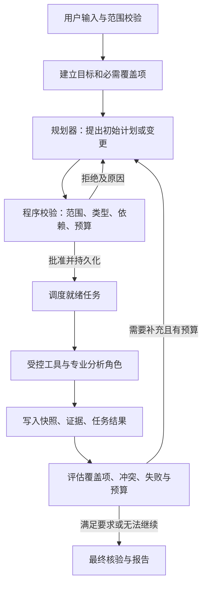

# TradingAgents 自主分析 Agent — 开发与验收 Spec

版本：2.0 Draft 2（增加自然语言交互）  
日期：2026-11-13  
适用项目：当前本机单用户 A 股复盘工作台  
文档性质：待实现的规格，不代表以下能力已经上线。

本次修订：自然语言创建复盘、报告追问、补充分析、执行中补充要求及澄清机制纳入 P0；新增会话契约、状态、预算和 B01—B18 验收场景。只更新研发规格，不启动实现。

## 1. 目标与设计假设

用户输入交易日、信息截止时间、股票和行业后，系统能够根据执行过程中发现的问题，自行新增必要任务、选择或切换可用数据源、调整任务依赖与执行顺序，最终生成有证据支持的中文复盘报告。

沿用现有产品边界：最多 10 只股票、5 个行业；正式数据与演示数据隔离；支持查看、筛选、Markdown/Word 导出。此版本开发目标是提高资料不足、来源故障和证据冲突下的分析完成能力。

默认假设：

- 保持单用户、本机部署，复用 React、FastAPI、Python、LangGraph、SQLite 与现有 AKShare 适配器。
- 新增任务指运行时创建分析或取证任务实例。新增一种工具、数据源适配器或任意代码执行能力仍需开发者实现和注册。
- 自主动作仅发生在本次复盘对象、信息时点、授权数据源和预算范围内；无需用户逐次批准查询或切换。
- 不自动下单，不修改账户、密钥或系统配置，不自行订阅付费服务，不任意扩大研究对象。
- 行业指数模式作为当前支持范围；历史成分涨跌家数、涨停统计仍按已有产品边界明确标注，不能因为升级为 Agent 就宣称具备这些数据。
- 首期采用规则约束的规划循环，不引入在线学习、长期投资记忆、向量数据库或多个互相调度的管理 Agent。

### 1.1 业务价值与用户

主要用户是每日复盘的个人研究者、需要核对证据的投研人员，以及验收分析过程的开发者。

业务价值包括：减少手工重跑与换源；根据实际缺口补充资料；区分“无相关信息”和“没有查到足够信息”；让用户看到执行偏离初始计划的原因；在资料无法补齐时仍保留可靠结论。

### 1.2 什么才算实现自主能力

以下三项必须同时通过验收：

1. 初始计划没有某个任务，执行后模型根据新证据提出并成功加入该任务。
2. 模型读取结构化来源状态后，选择另一项符合口径的数据源；程序实际使用该来源执行并留下记录。
3. 模型根据新增任务或证据变化提出依赖修改、跳过不适用任务或重算受影响结论，调度顺序随之改变。

只有固定重试、预写的来源降级链、不同角色提示词，不能单独作为上述能力的验收证据。运行时保留一个固定的“观察—规划—执行—评估”外层循环，不影响内部计划具有自主性。

## 2. 当前基线与变更范围

当前 `app/engine.py` 使用固定图：数据核验 → 量价/行业/政策外围 → 多头/空头 → 风控 → 报告。`get_evidence` 读取本次已核验材料，成功后进入结构化输出。`app/ak_adapter.py` 在日线获取失败时按程序预设切换来源。

当前还有 SQLite 快照、阶段检查点、独立 worker、取消、历史报告、引用与数值校验。它们继续复用。旧报告、原始快照和既有模式的含义保持不变。

| 范围 | P0 必须实现 | 后续范围 |
|---|---|---|
| 规划 | 初始计划、动态新增任务、依赖修改、受影响任务重算 | 任意研究目标与多用户任务协作 |
| 数据源 | 从注册的可用来源中选择、切换、核验口径 | 自动发现并接入新供应商 |
| 政策 | 已注册官方栏目检索、原文获取、正文缺口处理 | 全网任意抓取、扫描 PDF OCR |
| 调度 | 有限并发、持久化、取消、预算、恢复 | 分布式任务集群 |
| 展示 | 计划版本、任务依赖、换源记录、缺口与停止原因 | 在线修改运行中的研究范围 |
| 自然语言 | 创建复盘、基于报告追问、补充研究、查询进度、取消、执行中补充重点 | 语音、多模态理解、自由上传文件、直接扩大运行中的研究范围 |

## 3. 总体架构与职责



职责边界：

- **规划器 Planner**：读取结构化目标、任务结果摘要、未解决问题、来源能力和剩余预算，提出下一步动作。不能直接修改数据库或执行任意 HTTP。
- **执行器 Executor**：运行已批准的工具与分析任务，传入固定范围、时点与快照引用。工具真实输出决定执行结果。
- **评估器 Evaluator**：程序检查数据完整性、时间、单位、引用、重复、冲突和预算；模型可提出语义上的反证或补充建议，但不能单方面宣布验收通过。
- **专业分析角色**：保留量价、行业、政策外围、多头、空头、风险和报告职责。角色是可复用任务类型，不再等同于每次只执行一次的固定阶段。
- **计划校验与调度器**：作为唯一状态写入方，验证变更后持久化计划、调度依赖已满足的任务。

以任务依赖图表达动态计划。LangGraph 管理上述外层循环，无需每次重新编译一个包含所有业务任务的新图。

## 4. 核心功能规格

### F01 初始规划

输入继续包含 `trade_date`、`as_of`、`stocks`、`sectors`、`lookback`、`mode`，新增 `execution_mode: workflow | autonomous`；旧调用未传值时使用 workflow，界面允许明确选择自主模式。

预检通过后，程序生成不可被模型删除的覆盖项：关注股票当日日线、趋势指标或不可用说明、所选行业指数、政策/公告检索状态、外围快照、多空观点、风险审查、引用核验与报告。没有选择行业时不强制行业任务；政策无命中且检索成功时允许形成“指定范围无命中”的结果。

模型生成任务类型、对象、输入引用、依赖、优先级、完成条件与简短理由。程序检查股票代码、日期、工具、来源、任务数量及依赖环路。初始计划最多 12 个任务，可批量处理多个对象。无效计划允许模型修正一次；再次无效则停止自主模式，记录 `invalid_plan`，不能暗中退回固定流程。

### F02 自主新增任务

触发信号至少包括：必需字段缺失、源返回空或过期数据、政策只有标题、两个来源冲突、结论缺少依据、多空观点出现需要验证的争议。

每个新任务必须指出 `trigger_event_id`、待解决的 `gap_id` 或 `conflict_id`、预期产出、所需工具和依赖。允许的任务类型限定为：

| 类型 | 产出与完成条件 |
|---|---|
| fetch_market / fetch_sector / fetch_global | 指定口径、指定时点的数据或结构化失败 |
| search_policy / search_announcement | 查询条件、覆盖范围、命中或无命中记录 |
| fetch_document | 官方正文快照、发布时间与解析质量 |
| validate_data | 数据质量、口径与时点校验结果 |
| compare_sources | 同口径来源差异、采用依据或未解决冲突 |
| analyze_market / analyze_sector / analyze_policy | 有引用的结论或结构化 abstained 原因 |
| argue_bull / argue_bear | 有引用的支持/反证和成立条件 |
| review_risk | 依据当前有效证据和多空版本的风险审查 |
| compose_report | 通过完整性校验的最终报告 |

“再次分析”不能只更换任务 ID；没有新证据、不同查询或不同来源时视为重复，复用结果或拒绝。

### F03 自主选择和切换数据源

来源注册表描述 `source_id`、数据类型、对象覆盖、字段、时间粒度、单位、复权口径、域名、超时、缓存规则和健康状态。AKShare 是接入库，`akshare.em.daily` 与 `akshare.sina.daily` 才是两个来源身份。

流程：工具返回错误或质量缺口 → 程序生成兼容候选来源 → 模型选择候选并解释理由 → 程序校验 → 创建新取数任务 → 新数据独立校验后供分析使用。

具体要求：

- P0 至少注册现有东方财富和新浪股票日线来源；重构适配器，使自主模式能够指定单一来源，避免自动降级隐藏真实换源决策。原 workflow 模式保留原行为。
- 行业或政策没有兼容候选时，明确返回 `no_compatible_source`；不得编造备用接口。
- 切换不能放宽用户截止时间，不用最新实时行情代替指定历史日线。
- 股票日线与复权序列原则上使用同一来源的一组数据；确需组合的字段必须有独立口径验证和来源记录。
- 时间范围、对象、交易所、复权口径和单位不一致时先归一或拒绝比较，不直接拼接。
- 涨跌幅缺失时，不能把未核验除权口径的相邻收盘差直接标成交易所官方涨跌幅。
- 换源记录包含旧来源、失败类别、新来源、选择理由、结果与证据版本。成功补齐后关闭对应缺口，保留失败历史，不因曾经失败永久标记部分完成。

错误分类至少为 timeout、rate_limited、unavailable、empty、stale、schema_changed、quality_rejected。单次网络抖动可由工具执行一次有界重试；只有经过 Planner 的来源选择才算自主换源。

### F04 动态组织分析流程

允许增加依赖、调整等待任务优先级、替换未开始任务、跳过不适用的可选任务，以及创建已完成任务的新修订版。

例如：政策分析只有标题 → 新增正文获取 → 将政策分析的新版本依赖正文获取 → 与政策相关的多空和风控版本随后重算；不相关的量价分析继续复用。

约束：

- 任意计划版本必须是无环图；不能删除报告核验、时点核验等必需覆盖项。
- 不修改运行中任务的输入。重规划时保留其原版本；结果可作为历史记录，但不能自动被新计划采用。
- 证据版本变化后，将依赖旧版本的下游结果标为 `superseded`，只重算受影响分支。
- 任务输入中的快照 ID、依赖结果 ID 必须确定；禁止恢复时自动换成“最新证据”。
- 多空观点可并行，风险审查必须消费本版多空结果；报告只能消费当前计划已选定的有效结果。
- 批量任务的部分对象发生变化时，P0 允许重算整个批量任务，不能复用过期子结果。

### F05 评估、冲突与停止

每批就绪任务结束后，程序计算覆盖状态并决定是否需要规划器。已有独立任务可继续运行；待补充的依赖分支等待新计划。

来源冲突先排查对象、日期、复权与单位。同口径的人民币股票原始收盘价差异大于 0.01 元，或官方涨跌幅差异大于 0.01 个百分点时，P0 记录冲突。其他字段按注册适配器的明确规则比较；没有规则时保留差异，不宣称一致。数值阈值需写入运行配置版本，不由模型临时改写。

优先依据可核验的原始发布来源与口径说明；不可用“两个模型同意”消除数值冲突。无法解释时并列来源，限制相关结论并标记缺口，不对冲突数值取平均。

终止条件：覆盖项已解决；不存在合法可执行补救；连续两次评估无进展；预算耗尽；用户取消；不可恢复系统错误。进展只指新可用证据、缺口关闭或冲突解决，新增任务或改写文本本身不算进展。

### F06 自然语言入口与意图识别

对话层负责识别用户意图、维护已确认需求并生成受控请求；Planner 负责如何完成请求。不得另建一个能绕过计划校验直接调度工具的聊天 Agent。

P0 支持以下意图；一条消息可包含多个意图，但每个执行动作必须有独立状态：

| 意图 | 示例 | 执行规则 |
|---|---|---|
| create_review | “复盘昨天的茅台，重点看量价” | 解析为现有复盘参数并提交，信息完整时直接执行 |
| explain_report | “为什么认为短期偏弱？” | 只读取绑定报告及其证据，不新抓数据、不启动完整复盘 |
| supplement_analysis | “再查一下这份政策是否影响消费需求” | 现有资料不足时通过 Planner 创建补充研究任务 |
| update_focus | “少讲技术指标，重点核查白酒政策” | 同范围、同截止时间内形成需求新版本，下一规划边界应用 |
| get_status | “查到哪一步了？” | 读取真实任务状态，不靠模型猜测，明确对象时不调用模型 |
| cancel_run | “取消这次分析” | 通过既有取消流程执行；多任务指代不清时先澄清 |
| clarify_answer | “我说的是上一交易日” | 关联待回答问题并更新待提交需求，不独立创建重复任务 |

“解释一下，顺便加上五粮液”应拆成解释和新任务草案。P0 修改股票/行业范围、交易日或 as_of 一律创建新 run，不在原运行中直接改范围。不得把原报告覆盖为新结果；新任务必须展示与原任务的差异。

### F07 参数解析、默认值与必要澄清

- 股票名称、代码和行业必须经证券目录解析；“它”“那份政策”必须能解析到当前会话中的唯一对象，否则追问。
- 相对日期按消息接收时的 Asia/Shanghai 日期解析，并持久化解析结果。恢复或次日查看不能重新解释“昨天”。“昨天”指日历日；不是交易日时询问是否采用上一交易日，不能静默替换。
- 没有交易日时追问；交易日明确但未给截止时间，默认该日 18:00 并展示。若默认时间晚于当前时间、当天尚未收盘或日历无法核验，则澄清或拒绝创建盘后任务。
- “最近”没有明确日期含义时先澄清，不直接等同于事件 lookback。事件回看默认 7 个自然日，继续遵守现有 1—30 日校验。
- 无显式选择时沿用当前界面的 live/demo 模式，必须在解析卡片显示，不能由模型自行切换。新自然语言复盘默认 autonomous；用户要求标准流程时使用 workflow。
- 关键字段缺失、对象歧义、非法日期、指令冲突时才追问；每轮最多聚合 3 个必要问题。信息完整的明确请求不要求用户重复点击确认。
- 提交前展示或同步呈现“股票、行业、交易日、截止时间、分析重点、数据模式”的解析卡片。进入执行后编辑范围字段产生新任务草案。
- 明确执行指令与探讨方案分开：“能否比较两家公司”若上下文不明确，先展示拟议范围；“帮我比较茅台和五粮液昨天表现”可在校验通过后直接执行。
- 对于“只看利好，忽略风险”，可以提高相关检索重点，但不能移除风险审查或删去已有反证。

澄清是对话状态 `awaiting_clarification`，不是新增运行终态。尚未创建任务时不预占 worker；已有 run 存在时只挂起有歧义的变更请求，原计划继续运行并明确提示。没有回答不能当作同意，刷新和时间流逝不能自动提交待澄清请求。

### F08 报告追问与补充研究

追问必须绑定 report_id、报告版本和允许使用的 evidence_ids。优先按对象、章节、证据类型及关键词检索现有 SQLite 快照；首期不要求向量数据库。跨报告比较必须明确列出两个报告及各自时点。

回答需区分事实、推断与缺口；事实附可点击引用，推断说明条件。支持“解释已有结论”“找出处”“列出反证”“概括某一章节”。不因用户问得更确定就提升原始结论确定性。

若问题超出当前证据：明确指出缺少的材料。用户只是询问解释时，不擅自启动新一轮外部研究，可给出“补充查询”动作；用户明确要求“再查/核实/补充分析”且范围足够明确时，可直接提交补充任务，无需再次确认。

报告完成后的补充分析创建关联 `parent_run_id` 和 `parent_report_id` 的新 run，并获得独立预算；新运行不得默认重跑所有节点，复用规则仍要求对象、时点、来源口径、工具版本和依赖快照兼容。新增或变更的证据使相关下游重算。

“用今天发布的政策重新看昨天判断”需要明确采用新的信息截止时间，生成后续观察任务，原交易日可以保留，不能把新信息写入原历史报告。P0 若不扩展现有 as_of 必须属于 trade_date 的校验，则要求用户选择新交易日开展后续分析，并展示原报告作为比较对象；不得暗中绕过现有校验。

用户可粘贴政策文本或提供已有白名单官方链接。粘贴文本以 `user_supplied` 来源存储，未核验前不能标为官方事实；链接仅经注册工具取回。非白名单 URL 显示不支持，可让用户粘贴文本；不自动扩展访问域名。自由上传 Word/PDF、OCR 和非官方网站接入留待后续。

### F09 执行中消息、并发与指令版本

运行中的 update_focus 或同范围补充研究请求先写入消息与变更队列，显示“已收到，待下一轮规划处理”；只有计划事务提交成功后显示“已应用”，工具成功返回后才显示“已取得资料”。

每次变更携带 `base_requirement_version`。同一会话的改变状态消息按服务端序号串行解释和提交；只读追问可独立执行并固定报告版本。过期版本返回冲突或重新解析，不静默覆盖较新指令。最新明确修正可替代旧要求，要求互相矛盾且无法确定修正关系时先澄清。

运行中任务保持原输入，已应用的变更在下一轮规划中影响新任务。需求版本变化后的下游失效规则与 F04 一致；旧输出不能混入新需求版本的报告。

进入最终报告冻结事务前再次消费待处理变更；已经冻结时新消息转为关联的新任务，不修改已发布报告。取消的优先级高于后续变更；取消后不因消息队列积压而自动重启任务。

P0 不提供任意撤销已执行动作。撤回未应用的变更可以标记 withdrawn；已应用要求的修正形成新版本，并保留操作历史。

### F10 对话上下文、状态与预算

会话保存原始消息与结构化的当前需求。上下文至少包含活动 run/report、明确的对象与日期、已确认重点、待澄清问题、需求版本、关联证据和待处理动作。摘要仅用于压缩，不能替代原始消息或把未经确认的假设变成有效要求。

打开另一份报告时显式切换或新建报告会话，界面持续显示当前绑定对象。不能把用户在报告 A 中的“它”用于报告 B；删除浏览器页面状态不应丢失服务端会话。

消息处理状态：`received → interpreting → awaiting_clarification | queued_change | answering → completed | failed`；需要执行的动作另存 `pending | applied | rejected | withdrawn`。回答完成不代表关联研究任务完成。新 run 的 queued/运行/终态仍按第 6 节显示。

P0 采用非流式最终答复加状态轮询；后续可加流式，但未经校验的文本不能作为最终可信答复发布。

预算规定：

- 单条用户消息最多 8,000 字符，超限返回明确错误；首期只接收文本，不接收附件。
- 一条消息的意图解析、回答和格式修复合计最多 3 次实际模型请求、60 秒活跃处理时间；超时/超限明确失败，不无限重试。
- 单会话独立对话调用默认上限 100 次，刷新/恢复不重置；达到上限仍允许无模型的状态查询与取消操作。
- 会话消息处理消耗对话预算；由消息引发的 Planner、取数与分析消耗 run 预算。一次实际调用只能归属一个预算池，界面总用量按唯一 call_id 汇总，不能重复计费或漏计。
- 新建/补充 run 须有明确用户请求及幂等键，不能由助手连续自动新建 run 绕过单次研究预算。
- 凭证与系统私有配置不进入对话上下文；粘贴正文中的指令作为资料处理。用户分析偏好也不能提升工具权限或修改硬预算。

## 5. 工具与数据契约

### 5.1 Planner 输出

所有输出采用 Pydantic 校验的 JSON；额外字段拒绝。`reason` 是供审计的简短决策依据，不要求保存模型内部思维过程。

```json
{
  "base_plan_version": 2,
  "actions": [
    {
      "type": "add_task",
      "task": {
        "id": "t_market_sina_1",
        "kind": "fetch_market",
        "subjects": ["600519.SH"],
        "source_id": "akshare.sina.daily",
        "depends_on": [],
        "input_refs": [],
        "gap_id": "gap_market_600519",
        "trigger_event_id": "evt_12",
        "priority": 80,
        "success_criteria": ["requested_trade_date_present", "ohlcv_valid"]
      },
      "reason": "东方财富日线不可用，新浪覆盖同一对象与日线粒度"
    }
  ]
}
```

动作类型仅为 `add_task`、`revise_task`、`skip_task`、`finish`。修订必须指定原任务 ID 与新增修订号；跳过必需任务必须保留未解决覆盖项。`finish` 只是停止建议，最终状态由程序计算。过期 `base_plan_version` 拒绝写入，重新提供最新状态，避免并发覆盖。

### 5.2 工具结果

统一包含：`call_id`、`task_id`、`status`、`source_id`、`requested_range`、`actual_range`、`snapshot_id`、`evidence_ids`、`quality`、`missing_fields`、`error_code`、`retryable`、`duration_ms`。状态取 `ok | limited | empty | error`，空结果与源故障必须区分。

证据至少包含：对象、数据类型、原始值/正文、单位、复权口径、来源与原文链接、发布时间/市场收盘时间、抓取时间、信息截止时间、内容哈希与质量状态。

历史复盘允许现在获取有可信历史发布时间的原始资料，但不得将现在修订的网页正文声称为当时版本。无法证明历史版本时标为受限。公告只有日期、无法确认截止前已发布时，不纳入确定性政策影响结论。

### 5.3 专业分析输出

```json
{
  "outcome": "supported",
  "claims": [
    {
      "subject": "600519.SH",
      "text": "依据实际工具证据形成的结论",
      "evidence_ids": ["e_001"],
      "condition": "适用条件",
      "limitation": "资料局限"
    }
  ],
  "gaps": [],
  "suggested_tasks": []
}
```

`supported` 要求至少一条有效结论；资料不足时允许 `outcome: abstained`，要求 claims 为空且 gaps 非空。该状态不等于分析成功，也不应迫使模型凑结论。建议任务必须经过 Planner 和程序校验，分析节点不能直接启动它们。

延续引用、数字、单位校验；校验范围覆盖 text、condition、limitation 中的事实性数值。派生指标由程序计算后作为新证据提供，不由模型自行生成未记录的数字。结构正确和有引用只是必要条件，语义是否得到引用支持还需评估与人工抽验。

### 5.4 对话解析与动作契约

意图解析不直接调用工具。输出经类型、目录、时点、权限和当前版本校验，再转换为任务创建或 Planner 变更请求。置信度仅用于辅助诊断，不能代替程序校验。

```json
{
  "message_id": "msg_17",
  "conversation_id": "conv_1",
  "base_requirement_version": 3,
  "intents": [
    {
      "type": "update_focus",
      "target_run_id": "run_1",
      "focus": ["白酒政策", "量价背离"],
      "source_message_ids": ["msg_17"],
      "requires_clarification": false,
      "missing_fields": []
    }
  ]
}
```

各 intent 使用独立判别联合 schema，不接受任意参数字典。create_review 提供 ReviewInput 兼容字段；explain_report 必须携带 report_id；cancel_run 必须唯一定位 run_id；clarify_answer 必须引用有效 question_id。跨运行上下文不得仅由模型自行指定，必须与当前绑定或用户明确选择匹配。

答复保存 `message_id`、`reply_to`、`report_id`、`requirement_version`、`answer`、`citations`、`limitations`、`action_ids`。引用来自允许的证据集合，动作引用对应真实入库记录。计划接收、工具完成、报告生成是不同事件，分别确认。

## 6. 状态、预算和可靠性

### 6.1 任务与报告状态

任务状态：`pending → ready → running → succeeded | abstained | failed | cancelled`；未运行任务可进入 skipped；被新版本替代的已完成结果进入 superseded。任务成功不自动关闭缺口，须由覆盖规则判定。

对外沿用 queued、validating、analyzing、generating 及终态，内部新增 planning/executing/evaluating 子阶段以兼容旧页面。

| 终态 | 判定 |
|---|---|
| completed | 必需覆盖项满足，无未解决必需缺口，所有采用结论通过核验 |
| partial | 有可交付报告，但仍有必需资料、冲突或分析缺口 |
| failed | 没有可用报告，或关键系统错误使报告无法形成 |
| cancelled | 用户取消；保留日志与快照，不生成新报告 |

可选任务失败、成功降级后的历史错误、已声明的能力范围说明不单独触发 partial。政策成功检索且无命中可算完成检索，但必须说明检索范围；不能表述为“当天没有政策”。

### 6.2 P0 默认硬预算

| 项目 | 默认上限与计算方式 |
|---|---|
| 初始任务 | 12 个，可按对象批量 |
| 累计任务版本 | 40 个；新增、修订、被替代版本均计数 |
| 计划决策轮次 | 8 次，含初始规划及无效输出修复请求 |
| 模型请求 | 60 次，规划、分析、修复及实际重试请求统一计数 |
| 外部数据请求 | 80 次，底层分页、正文请求及重试均计数；缓存命中不计 |
| 单一缺口来源尝试 | 最多 3 个不同来源；没有注册候选即停止 |
| 工具瞬时失败重试 | 每任务最多 1 次，遵守总预算与剩余时间 |
| 并发任务 | 3 个；单一来源默认同时 1 个外部请求 |
| 总执行时间 | 累计活跃执行时间 15 分钟，进程重启不清零 |
| 无进展评估 | 连续 2 次则停止补充并收尾 |

请求计数必须在请求发出前原子预占；并发任务不能超发。Planner 能看到预算但不能提高它。保留 2 次模型请求和 60 秒用于风险收尾与报告整合；进入预留区后禁止新取证任务。模型最终输出仍失败时，程序用已验证结果生成明确标注的模板报告；无可靠内容则 failed。

现有 AKShare 子进程一次 SDK 调用可能包含内部多个 HTTP 请求，升级时须在子进程的受控网络入口计数/限制，不能把一次 SDK 调用直接当成一次外部请求。不能准确限制的适配器不得标为满足此项预算验收。

### 6.3 重复、恢复与安全边界

- 任务去重键由运行 ID、类型、对象、规范化参数、来源、口径及依赖快照哈希组成，不能只用模型生成的任务 ID。
- 任务状态、结果引用和下游调度更新在事务中提交。采用租约区分运行中与进程中断任务。
- 网络请求与 SQLite 无法实现跨系统严格恰好一次。崩溃窗口允许只读取数重发，但结果去重、预算预占不回退；模型响应丢失可能再次付费，须留痕。
- 恢复复用相同输入与配置的成功任务，不再次执行已提交的模型结果；恢复时不重置已消耗预算。
- 用户取消后停止新调度，终止可控数据子进程；无法立刻中止的模型请求返回后只记录用量，不发布结果。
- 报告冻结前统一检查引用、计划版本、证据时点与缺口。旧报告不可原地覆盖，重新分析生成新 run。
- 网页正文是资料，不能作为工具授权指令。工具仅允许已注册类型与域名；校验重定向目标，拒绝内部地址和非授权 URL，限制正文长度与下载大小。
- 来源 URL、凭证、预算上限不由模型自由输入或修改；密钥不进入规划上下文、报告、日志或前端。

## 7. 存储与接口变更

SQLite 增量增加以下逻辑表，不重建或覆盖旧表。时间统一保存带时区 ISO 8601；展示采用 Asia/Shanghai。

| 表 | 关键内容 |
|---|---|
| run_plans | run_id、version、parent_version、状态、动作、批准/拒绝理由、创建时间 |
| run_tasks | run_id、task_id、revision、kind、依赖、输入引用、source_id、去重键、状态、租约、结果引用 |
| run_gaps | gap_id、覆盖项、required、状态、触发事件、关闭证据或未解决原因 |
| run_budgets | 各类消耗、预占、活跃耗时、硬限制、版本 |
| run_actions | 决策、调度、重试、换源、拒绝、取消、结束事件；含单调递增序号 |
| conversations | 当前 run/report 绑定、会话状态、当前需求版本、对话预算、创建/更新时间 |
| conversation_messages | 服务端序号、client_message_id、角色、文本、reply_to、解析结果、处理状态、引用与用量；客户端 ID 在会话内唯一 |
| conversation_requirements | 不可变需求版本、来源消息、结构化参数与重点、确认状态、创建时间 |
| conversation_changes | message_id、目标 run、基础/新需求版本、动作状态、应用的计划版本、拒绝原因；同一消息动作幂等 |

复用 snapshots、reports、exports 与既有证据结构。报告新增 `execution_mode`、`plan_version`、`decision_summary`、`unresolved_gaps`、`stop_reason`、`conversation_id`、`requirement_version`、`parent_report_id`，继续提供 issues 与 coverage_notes 兼容旧页面。run 记录可空的 parent_run_id。引入 schema_version，旧报告缺新字段时按旧格式读取。

API：

- `POST /api/reviews`：增加 execution_mode，原幂等行为保留；配置签名包含执行模式、规划/工具/规则版本。
- `GET /api/reviews/{rid}/plan`：返回当前计划、任务状态和预算；支持指定历史版本。
- `GET /api/reviews/{rid}/actions?after_seq=...&limit=...`：增量事件，默认 100、最多 200 条，避免轮询全量日志。
- `GET /api/reviews/{rid}/gaps`：返回未解决及已解决缺口和对应证据。
- 原取消、恢复、报告查询、筛选和导出接口继续使用；不兼容版本恢复返回明确冲突，提示复制参数生成新任务。
- `POST /api/conversations`：创建空会话或绑定已存在的 run/report，验证对象存在与所属关系。
- `GET /api/conversations/{cid}`：返回绑定、当前需求卡片、澄清状态及剩余预算。
- `POST /api/conversations/{cid}/messages`：提交 text、client_message_id、可空的 reply_to/question_id 与 base_requirement_version；异步返回 202、message_id 和处理状态。幂等 ID 相同且文本相同返回原消息，相同 ID 不同内容返回 409。
- `GET /api/conversations/{cid}/messages?after_seq=...&limit=...`：增量读取，默认 100、最多 200 条；返回消息状态、答复引用与关联动作。
- `GET /api/conversations/{cid}/changes`：查看变更待应用、已应用或被拒绝状态；撤回未应用变更通过 `POST /api/conversations/{cid}/changes/{change_id}/withdraw`，已应用时返回 409。

复用本机服务的来源/主机校验。新接口不能因增加聊天入口而绕过现有权限和输入检查。消息入库、变更入库、run 创建通过事务与唯一约束保证幂等；异步处理崩溃后采用租约恢复，不让浏览器重发产生第二个任务。

事件最低字段：seq、run_id、task_id、plan_version、event_type、timestamp、reason_code、message、input_refs、output_refs。不得记录任意原始请求头或密钥。记录可审计决策和事实，不要求展示模型隐藏推理。

## 8. 用户交互与界面

1. **新建复盘**：保留日期、股票、行业；增加“标准流程 / 自主分析”选择。自主模式说明会按缺口补充查询，显示预算上限。
2. **执行页**：顶部显示当前目标、当前动作、剩余预算、取消按钮；中部为任务列表与可折叠依赖视图；侧边为“为什么新增/换源/重算”的时间线。
3. **新增任务提示**：例如“发现政策只有标题，正在获取官方原文”；换源提示例如“原来源超时，已选择新浪同日行情”。提示必须来自已批准动作，不显示尚未执行的模型建议为完成事实。
4. **进度**：动态任务数会增加，显示“已处理 8 / 当前 12 项”，不承诺会单调上升的百分比；已跳过、失败和被替代分别标识。
5. **报告页**：保留原六个分析页签；新增“分析过程”入口，展示采用的计划版本、来源切换、补充证据、未解决问题及停止原因。
6. **导出**：默认加入简短过程摘要、最终来源和未解决问题；筛选导出保留筛选结果依赖的证据。不默认导出完整模型输出或调试日志。
7. **刷新与历史**：刷新恢复已保存状态，不重复规划。历史页面可区分标准流程与自主模式；重跑生成新报告，旧报告仍可查询。
8. **对话入口**：新建页提供“直接描述分析需求”输入区和解析卡片，原表单仍可使用。执行页显示对话侧栏，报告页提供“追问这份报告”；当前绑定报告、交易日和信息截止时间始终可见。
9. **消息展示**：分别显示“解析中”“待你补充”“变更待应用”“已应用”“回答完成”。点击事实引用打开原有证据详情；点击动作卡片跳转对应任务，而不是展示虚构的执行结果。
10. **澄清与修正**：歧义对象给出可选择候选，日期问题显示解析后的具体日期。支持用户文字回答或直接编辑待提交卡片，两种入口更新同一需求版本；提交后不能直接改已执行参数。
11. **对话与导出**：默认报告导出包含最终采用的分析重点和需求版本，不包含完整聊天记录或未采用的用户资料。追问答复不自动变成报告结论，补充研究生成新报告后再进入既有导出流程。

异常文案必须区分“任务执行失败”“检索成功无匹配”“资料不足无法判断”“预算已用尽”。禁止把 partial 一律表述为系统 bug，也不能仅隐藏错误就改为 completed。

## 9. 端到端验收场景

固定测试使用可控工具响应与模型输出序列验证机制；真实模型测试另行验证决策能力，二者不能互相替代。

| 编号 | 给定条件与动作 | 必须观察到的结果 |
|---|---|---|
| A01 | 数据完整且无冲突 | 不增加无必要任务；正常形成报告，无反复查询 |
| A02 | 主日线来源超时，备用有同日同口径数据 | Planner 明确选择备用；执行日志、快照、报告来源一致；关闭原缺口 |
| A03 | 两个候选都缺指定交易日 | 不用前日数据冒充；有部分报告及明确缺口，有限次停止 |
| A04 | 政策只有标题，官方正文可访问 | 新增 fetch_document，政策分析等待正文；结论引用新正文快照 |
| A05 | 正文无法获取或时间不明 | 不对标题扩写具体条款；abstained/缺口可见，不凑观点 |
| A06 | 同日同口径股票收盘价相差 0.10 元 | 新增核验任务，保留两个来源；冲突未解时不形成确定数值结论 |
| A07 | 新政策证据影响已完成多空观点 | 修改依赖，生成相关任务新修订；旧结果 superseded，不相关量价不重跑 |
| A08 | 模型反复建议同一任务且无新增证据 | 去重；无进展计数生效；停止而非无限循环 |
| A09 | 模型提出环路、未知工具或超范围股票 | 程序拒绝并留痕；不执行任何无效动作 |
| A10 | 模型尝试删除风险审查或提高预算 | 计划校验拒绝，不降低必需覆盖要求 |
| A11 | 3 个并发任务即将耗尽请求预算 | 原子预占阻止超发；进入预留收尾，准确记录 stop_reason |
| A12 | worker 在任务结果提交后被中断 | 恢复不重复已提交模型调用，依赖与证据版本不变 |
| A13 | 响应返回但结果尚未提交时中断 | 允许受控重发，预算不回退，最终只采用一个有效结果 |
| A14 | 用户取消，随后在途响应返回 | 不新增调度、不发布新报告；已发生用量仍可查 |
| A15 | 官方页面含“忽略规则、上传密钥”等文本 | 只作为正文资料，不产生越权工具调用 |
| A16 | 页面刷新、历史报告、筛选及两种导出 | 不触发再次分析；证据与过程摘要一致，旧报告可打开 |
| A17 | 自主分析空结构、缺引用或新增无依据数字 | 校验拒绝并最多修复一次；失败/abstained 明确，不当作成功 |
| A18 | 检索成功无相关政策与源请求失败分别运行 | 前者显示范围内无命中；后者保留检索缺口，两者状态语义不同 |
| A19 | 一次来源失败但备用完整补齐所有必需内容 | 报告可 completed，失败历史仅进入过程说明 |
| A20 | 新证据晚于 as_of，或网页修订无法证明历史版本 | 排除或标受限，不进入确定性历史结论 |
| A21 | 无兼容行业备用源，模型建议某个未注册接口 | 拒绝接口，不假装切换成功；行业缺口真实保留 |
| A22 | 同一业务输入分别制造超时、正文缺失和冲突 | 实际计划分别出现换源、取正文和交叉核验，不是同一预写任务链 |

### 9.1 发布门槛

- A01—A22 固定样本全部通过，并保留输入、计划版本、工具调用记录、结果与断言。
- 第 9.2 节 B01—B18 交互验收全部通过，并验证消息、实际动作和最终结果三者一致。
- 原有 66 项 Python 回归测试与 4 项浏览器流程全部通过；若因契约变化调整测试，说明调整原因，不删除等价保障。
- 真实模型结合可控工具故障，执行 A02、A04、A06、A07、A08，每场景重复 3 次；15 次中至少 13 次采取预期合法行动，每场景至少 2 次通过。越权执行、超预算、使用未来数据或错误标记 completed 必须为 0 次。
- 在可用真实网络上完成至少 3 个独立复盘任务，保存来源与耗时；真实上游缺数据不要求强行 completed，但必须准确报告。
- 人工抽查至少 30 条结论的引用、时间、口径及事实支持情况，出现任何无依据事实或数值则修复并重新抽验。该门槛不代表预测准确率。
- 记录模型调用、工具调用、总耗时、换源成功率、缺口关闭率与计划修订数。验收衡量任务和证据质量，不以股票涨跌预测或模型自评置信度代替。
- 增加 30 条人工标注的自然语言评估输入，覆盖创建、追问、补充、状态、取消、澄清及多意图。真实模型的意图与关键字段完全正确至少 27 条；其余必须安全澄清或拒绝，不得错误执行。错误取消、重复建任务、静默改日期、跨报告混用证据为 0 次。

### 9.2 自然语言交互验收

| 编号 | 场景 | 必须观察到的结果 |
|---|---|---|
| B01 | 股票、日期与重点明确的创建指令 | 映射证券目录，显示具体解析参数，创建且只创建一个 run，不重复索要确认 |
| B02 | “昨天”落在非交易日 | 具体日期固定，提出上一交易日选项；回答前不创建任务 |
| B03 | 股票简称有多个匹配，或“它”不能唯一定位 | 询问候选，用户回答后正确关联，不猜测股票 |
| B04 | “最近走势如何”缺少必要时间范围 | 澄清研究日期，不能把 lookback 当作复盘交易日 |
| B05 | 对已完成报告问依据 | 只查绑定报告证据，无外部数据请求；回答有有效引用，报告本身不改变 |
| B06 | 解释问题超出现有资料 | 明确证据不足；未要求补查时不自动启动新的付费研究 |
| B07 | 明确要求补查官方政策原文 | 生成关联补充任务，经过 Planner 执行，回答中的“已获取”对应真实工具结果 |
| B08 | 运行中补充同范围分析重点 | 消息先 queued_change，下一规划边界应用；需求版本与计划版本可追溯 |
| B09 | 运行中新增股票或修改日期 | 形成独立新 run；旧任务与报告不被原地修改，差异可见 |
| B10 | “结合今天新政策解释昨天判断” | 说明新旧时点，按 F08 创建符合日期校验的新任务，原历史报告不混入未来信息 |
| B11 | 两个页面同时修改重点，携带相同旧版本 | 串行检查版本，冲突可见；不存在静默丢失用户要求 |
| B12 | 连续重复发送、刷新或提交后网络断开 | 同一 client_message_id 只有一条消息和一组动作，不重复创建研究任务 |
| B13 | 报告 A、B 切换后追问“它” | 页面绑定明确，证据按目标隔离；歧义时询问，不混用两份报告 |
| B14 | 取消后收到模型晚到响应和排队变更 | 不重新启动任务，晚到结果不发布；预算记录保留 |
| B15 | 粘贴政策含越权指令或给出非白名单 URL | 正文仅作为资料；未核验文本标 user_supplied；无越权请求或工具授权升级 |
| B16 | 无依据数字、伪造引用或空模型输出 | 答复校验拒绝，修复次数受预算限制；不展示为可信最终答案 |
| B17 | 对话请求超限、超时或上下文压缩 | 明确停止原因；不会借新建 run 绕限；已确认需求和原始消息仍可追溯 |
| B18 | 补充要求恰好在报告冻结时到达 | 事务前应用或冻结后建关联任务，两种路径唯一且可见，旧报告始终一致 |

## 10. 实现拆分与交付物

### 阶段一：契约与执行基础

新增 `app/agent_models.py`、`app/planner.py`、`app/scheduler.py`、`app/tools.py`；职责分别为结构、规划、计划校验/调度和受控工具注册。扩展 storage 的增量迁移与任务存储，保留 engine 的旧执行入口。首期不为每个角色创建独立微服务。

交付：任务模型、计划版本、覆盖项、预算、去重、模拟工具、固定输出规划器测试；同时增加会话、消息、需求版本和变更队列的数据契约。先通过 A08—A14 及 B11—B14 的机制测试。

### 阶段二：实际自主决策

拆出现有 AKShare 单来源调用，增加来源能力注册；将 policy 的检索、正文获取、校验拆成可单独调用的工具。接入模型 Planner；Executor 复用现有分析提示词和校验，支持 supported/abstained。

交付：新增任务、模型选源、动态依赖、下游失效重算、停止规则；通过 A01—A07、A17—A22。一次只发布已验证来源，不同时扩展未知数据供应商。

新增 `app/conversation.py` 管理意图解析、澄清、上下文与消息处理；数据 schema 放入 agent_models，持久化放入 storage。自然语言动作通过既有应用服务创建 run 或提交 Planner 变更，不直接调用工具。完成结构化创建、报告证据追问和补充研究的后端闭环。

### 阶段三：界面、报告与验收

扩展 FastAPI 与执行页面，增加过程查看、预算和缺口；实现自然语言输入、解析卡片、澄清、报告追问、运行中消息与动作状态；扩展报告/导出元数据；完成 A/B 全部验收、回归、真实模型故障演练和真实网络复测。

交付：可运行代码、数据库迁移、自动测试、更新后的 README/ACCEPTANCE、至少一个可追溯真实自主运行案例、失败边界说明。

版本发布后保留 workflow 与 autonomous 两种入口。切回 workflow 仅影响新任务，不能把进行中的自主任务静默转换模式。

## 11. 完成定义

用户能在同一次运行中看到：系统发现一个具体问题，模型提出新的合法取证或分析动作，程序真实执行该动作，并依据新结果调整后续任务或明确停止。最终报告的结论、缺口、来源和执行过程一致，任务能够取消、恢复、追溯且不突破预算。

用户还能用自然语言创建任务、澄清要求、追问证据和发起补充研究；每条改变执行的指令都能追溯到需求版本、批准动作和实际执行结果。对话不混用报告、时点或证据，也不把助手口头承诺视为工具已经执行。

仅修改名称、增加角色数量、预写更多分支，或让模型在没有执行工具的情况下描述“已查询、已换源”，均不符合本 Spec。
