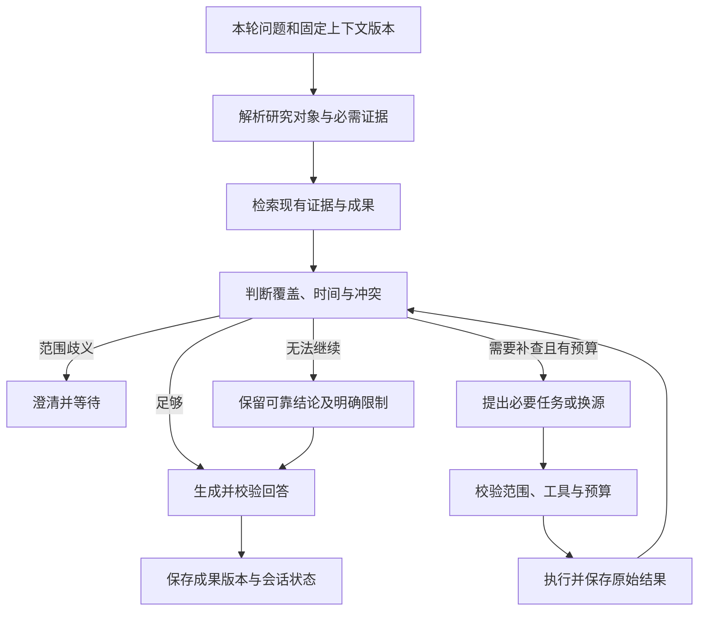

# TradingAgents V3「连续对话投研」开发与验收 Spec

版本：3.0 Draft 1  
日期：2026-11-13  
适用项目：本机单用户 A 股投研与复盘工作台  
文档状态：研发规格；本文要求不代表功能已经实现。  
关联文档：[V2 自主 Agent Spec](./SPEC_AUTONOMOUS_AGENT_V2.md)、[当前升级记录](./UPGRADE_V2.md)。

后续增量规格：[V4 投资论证与多空裁决 Spec](./SPEC_INVESTMENT_REASONING_V4.md)。V4 用于下一轮分析增强研发，不替代本文的验收要求；V3 未完成项见 [实现与验收进度](./IMPLEMENTATION_V3.md)。

## 1. 产品目标与业务价值

将产品从“通过自然语言创建复盘、追问一份报告”，升级为“围绕同一个研究问题连续讨论、检索证据、补充取数、比较对象并保留研究过程的投研助手”。

目标用户为个人投资研究者、需要反复核对结论的投研人员，以及执行验收的产品与开发人员。典型需求是先研究一个对象，再追问原因、核对依据、增加比较对象、查询公告，并在稍后恢复讨论。

业务价值：减少重复输入；降低在报告、行情、公告之间手工查找的成本；消除已有证据未送入模型造成的假性缺口；让新问题能够触发必要的研究动作；让结论、时点与来源可核查。

V3 的成功标准：用户不必重复描述已经明确的信息，系统能够识别缺少的证据并采取允许的补查行动；无法获得资料时，仍给出有边界的回答及真实原因。

对标问财的自然语言投研体验；借鉴 Vibe-Trading 的会话、上下文、工具循环与成果版本设计。V3 不承诺达到商业产品的数据覆盖、实时性与全市场选股能力，也不以 Agent 数量作为完成标准。

## 2. 当前基线与必须修复的问题

以下为本次规格编写前的本地代码检查结果，不等于对所有用户问题均已复现。

| 编号 | 当前实现/问题 | V3 必须达到的行为 |
|---|---|---|
| B01 | 已持久化聊天，但报告回答没有传入前文问答 | 理解与回答共同使用同一份版本化上下文 |
| B02 | 意图识别取前 200 条消息中的最后 8 条 | 按当前轮之前的最新消息取尾部，长会话不读错历史 |
| B03 | 报告回答直接截取前 30 条证据 | 依据问题检索、排序、逐步扩展，不按插入顺序截断 |
| B04 | 报告追问禁止自动补查 | 同范围、已授权、预算内的必要只读补查可自动执行 |
| B05 | 会话以单个当前 run/report 为主要关联 | 会话可拥有多个研究任务与成果，明确当前讨论对象 |
| B06 | 缺口主要以文字描述 | 结构化区分未检索、未获取、无记录、故障、过期、冲突与不支持 |
| B07 | 当前验证以单轮解析和任务执行为主 | 增加连续追问、纠正、跨对象比较、长会话、刷新与恢复验收 |

已有基础继续复用：React 页面、FastAPI、Python、SQLite、AKShare 适配器、受控任务调度、工具预算、原始快照、证据引用、任务取消、历史报告、Markdown/Word 导出。

V2 的历史描述不作为当前实现事实。V3 与 V2 冲突时，本 Spec 中关于会话、追问、补查、版本及预算的规则优先；未变更的既有范围、来源授权、数据校验和报告兼容要求继续有效。

## 3. 范围、默认决策与非目标

### 3.1 P0 必须交付

1. 同会话多轮理解、指代消解、用户纠正、话题切换与澄清。
2. 结构化研究上下文、近期消息、长会话摘要与按需历史回取。
3. 问题驱动的证据检索、充分性判断、预算内自动补查与来源回退。
4. 单股研究、明确指定股票间的比较、明确选择行业后的行业分析。
5. 行情与已支持指标、公告、已注册官方政策与外围行情的连续追问。
6. 会话内结果表筛选、排序和引用；不等同于全市场选股。
7. 会话历史、恢复、当前研究范围、执行进度、缺口和引用展示。
8. 不可变成果版本、补查与原成果关联、旧报告访问和兼容导出。
9. 幂等、需求版本、取消、进程恢复、预算与可追溯事件。
10. 本文规定的自动化测试、真实模型评测及人工验收材料。

### 3.2 P1 / 后续范围

全市场自然语言条件选股、财务与估值数据库扩展、研报搜索、用户文件上传与 OCR、跨会话自动偏好学习、长期投资记忆、语音、定时监控、多用户协作、移动端独立 App。

不在本版实现：自动下单、券商账户、交易策略回测、模型自主编写并执行任意代码、任意网址抓取、自动注册新数据源、自动购买或升级付费服务。

### 3.3 已确认约定与实现默认值

| 项目 | 决策 |
|---|---|
| 仅输入股票 | 只分析股票，不自动添加行业；可提供添加行业入口 |
| 用户明确说“和五粮液比较” | 该消息即授权加入五粮液，继承未修改的日期及口径，不重复确认 |
| 对象上限 | 保持最多 10 只股票、5 个行业；超过上限先澄清如何缩小 |
| 部署 | 本机单用户，正式与演示数据隔离 |
| 自动补查 | 默认开启，仅限当前问题必需、已授权工具及预算；可切换“仅使用现有资料” |
| 范围扩大 | 用户明确请求可直接执行；模型自行提出新的股票或行业需先取得用户选择 |
| 外围与宏观背景 | 可在原问题需要的范围内查背景材料，不把相关个股/行业自动变成研究目标 |
| 历史结论 | 不静默修改；新证据形成新成果版本 |
| 新会话 | 不自动继承其他会话的对象和结论；用户主动打开旧会话或引用旧成果除外 |
| 不确定信息 | 影响对象、日期、统计口径或费用时澄清；不影响正确性的表达偏好可采用明确默认值 |

这些默认值是本版建议的开发基线。研发若需要变更权限范围、支持市场、预算上限或日期语义，应列出具体冲突并与用户确认，不得自行扩大范围。

## 4. 核心用户旅程

### 4.1 主验收旅程

前提：使用已配置的数据源；固定测试时钟与交易日历；指定日期有对应测试数据。

| 轮次 | 用户输入/动作 | 预期行为 |
|---|---|---|
| 1 | 复盘 2026-11-13 的贵州茅台，重点看量价 | 建立单股研究；行业为空；展示交易日与信息截止时间 |
| 2 | 它为什么放量？ | “它”指向茅台；先核验量比及比较基准，再解释可能原因，不将相关性说成因果 |
| 3 | 你刚才第二个依据来自哪里？ | 定位上一回答第二个依据，展示引用片段、时间、来源和计算过程；无需重新取数 |
| 4 | 和五粮液比较一下，日期不变 | 加入五粮液，保留茅台及日期；按共同可用指标生成比较表 |
| 5 | 再检查这两家的公告 | 两家对象继承；默认沿用当前回看区间与截止时间；缺失时真正调用公告工具 |
| 6 | 刷新页面，再输入“继续刚才的比较” | 恢复同一会话、比较对象、成果和待办；已完成部分不无故重跑 |
| 7 | 把比较结果导出 | 导出所指成果版本；引用及缺口与页面一致 |

### 4.2 补充旅程

- 纠正：“不是茅台，刚才说的是五粮液”→更新当前对象；旧结论保留原归属，不把旧价格迁移到新对象。
- 新话题：“先不看白酒了，分析宁德时代”→新建会话内研究线程；明确日期是否继承，歧义时询问；原线程保留。
- 历史接续：“接着昨天的分析”→先查会话历史；存在多条匹配时列候选；“昨天的分析”不是将行情日期强制改成昨天。
- 限制取数：“只根据这份报告回答”→禁止外部补查，允许读取报告关联快照；证据不足时说明具体缺项。
- 撤销：“取消刚才的补查”→仅取消对应活动轮次的任务，不删除前文及已有成果。
- 无记录：公告查询明确成功且零条→说明查询对象、区间及来源，不报接口故障，也不扩大为“公司没有任何公告”。

## 5. 领域对象与上下文模型

### 5.1 对象关系

| 对象 | 含义与生命周期 |
|---|---|
| Conversation | 用户可打开和恢复的一段对话，拥有消息、多个研究线程和成果引用 |
| ResearchThread | 会话中的一个研究主题，拥有范围、上下文版本和当前成果；话题切换不删除旧线程 |
| Message | 用户或助手消息；保留原文。普通研究消息形成一个 Turn；澄清答复、确认及控制消息关联原 Turn，不重复建立研究预算 |
| Turn | 当前问题的理解、检索、补查、回答过程；一次用户消息至多创建一个研究 run |
| Run / Task | 已有受控执行与任务依赖图；可被 Turn 引用；可不生成完整复盘报告 |
| Evidence | 可检索证据，引用原始快照及字段/文档片段；必须有来源与时间口径 |
| ArtifactRevision | 一份回答、比较表或报告的不可变版本，保存结论、引用、范围与缺口 |
| ResultSet | 当前表格的结构化结果集，记录来源、字段口径、筛选与排序，不仅保存展示文本 |
| Gap | 针对当前问题覆盖项的缺口，包含类型、影响及已尝试动作 |

会话、线程、轮次、run 和成果必须使用独立 ID；不得继续假设“当前 run 就是整个会话”或“所有成果 ID 等于 run ID”。现有报告 ID 保持兼容。

### 5.2 上下文快照必需字段

| 字段 | 约束 |
|---|---|
| schema_version / context_version | 结构版本及乐观锁版本，单调递增 |
| conversation_id / thread_id / turn_id | 固定归属，不由模型自由决定 |
| goal / current_question | 原研究目标与本轮问题分别保存 |
| subjects | 股票代码、市场、名称；行业单独保存；附来源消息 ID |
| temporal_scope | trade_date、as_of、lookback、timezone、historical/latest 模式 |
| focus / constraints | 分析重点、仅现有资料、禁止扩展行业等显式限制 |
| referents | 最近讨论对象、比较对象、上个回答的 claim ID、结果集和表格行引用 |
| artifact_refs / run_refs | 当前与关联成果、任务 ID，不复制所有大结果 |
| pending_questions / pending_actions | 待澄清内容、未完成请求与状态 |
| recent_messages / summary_ref | 本轮之前的近期历史及摘要版本 |
| resolved_corrections | 用户纠正、被覆盖的字段及消息来源 |
| evidence_manifest | 已有证据的索引摘要、覆盖与时效；不是全部原始内容 |

优先级：用户本轮明确要求 > 尚有效的用户纠正及限制 > 当前线程结构化状态 > 近期原始对话 > 历史摘要。检索到的事实证据不能改变用户授权；用户陈述也不能直接覆盖已经核验的市场事实，应记录为待核对主张。

### 5.3 指代与纠正规则

1. “它”只在唯一活跃对象或明确上一句主语下直接解析；多个候选且无法确定时只问必要问题。
2. “这两家”使用当前明确的比较对象集合；不得猜成整个自选股列表。
3. “第二点”优先解析 reply_to 指向的回答，其次最近一条有编号结论的回答；无编号或多个候选则澄清。
4. “还是按原来的”引用明确的上下文版本；存在多个改动时显示待恢复的参数，不能恢复一个猜测版本。
5. 用户纠正后，受影响的待执行任务取消/替代；已经产生的结论保留旧对象标签并标记不适用于新范围。
6. 模型回答内容不是自动生效的用户偏好或事实记忆；仅保存带来源的观察、决定和可验证结论。
7. 同一轮只能读取 seq 小于本轮用户消息的历史；不读取排队中的未来消息作为既有对话。

### 5.4 时间与日期语义

- 默认时区 Asia/Shanghai；明确展示行情日期和信息截止时间，两者不能混同。
- 用户要求历史复盘但只给交易日：默认信息截止为当日 18:00，沿用现有规则并展示；若该时刻尚未到达，不使用未来截止时间。
- 交易日当天已收盘但未到 18:00：可使用消息接收时刻作为截止，明确“截至当前”；盘前/盘中要求当日完整盘后复盘时，说明尚未形成完整数据并让用户选择最近已完成交易日。
- 无日期但正在追问当前研究：继承；新研究无可继承日期：询问。用户明确“最新/最近一个交易日”时可查交易日历解析，不能按工作日猜测。
- “昨天”指接收时刻前一个自然日；若非交易日，提示并提供最近交易日候选。“上一交易日”通过交易日历解析。
- “日期不变”固定已有日期与 as_of。“最新公告”如果超出历史研究 as_of，需说明将建立当前时点的补充研究并澄清，不能混入旧时点报告。
- 正式来源发布时间晚于 as_of 的材料不得作为当时已知证据；只有日期且不能核验发布时间的材料标记时间不确定。
- 财务期末、公告发布日期、行情交易日、采集时间分别保存，不互相替代。

## 6. 上下文构建、压缩与会话恢复

### 6.1 每轮统一构建

意图解析、问题规划和最终回答使用同一个 context_version；回答可追加本轮工具结果，但不得悄悄改用另一线程的范围。

顺序：加载本轮消息 → 解析 reply_to/成果绑定 → 读取结构化状态与用户限制 → 读取最新原始历史 → 必要时回取更早消息 → 检索证据 → 记录实际送入模型的内容清单。

近期历史默认最多 12 轮完整问答，但同时受 token 上限约束；不足一轮不得截断出失配的工具调用/返回。必须按本轮之前的最新消息倒序分页后恢复时间顺序，禁止“前 N 条再取尾部”。

### 6.2 长会话摘要

- 达到上下文软阈值时摘要已完成的旧轮次，保留原始消息用于核查。
- 摘要结构：目标、有效范围、用户约束、纠正记录、已完成事项、关键结论及引用、未回答问题、失败工具及原因、当前成果。
- 每个关键事实带 message/claim/evidence 引用；无原文依据的摘要内容不能成为新事实。
- 摘要保存 covered_through_seq、来源消息哈希、生成版本与时间；提交前检查上下文版本仍匹配。
- 新的用户纠正覆盖旧摘要对应字段；后台摘要不得覆盖新纠正。
- 摘要失败保留结构化状态和近期消息，按需读取历史；显示上下文恢复受限，不清空会话。
- 原始工具大结果保存在快照中，模型只接收摘要和可回取位置；压缩后能够按引用恢复原值，避免重新请求网络。

建议默认上下文输入上限为 min(16,000 tokens，模型声明窗口扣除输出及工具定义后的可用额度)，达到 75% 时触发压缩。模型窗口未知时使用保守 8,000-token 输入上限；记录实际 token 或估算方法。禁止为了保留闲聊而丢弃当前问题、显式约束和引用依据。

### 6.3 恢复与历史查找

- 刷新和服务重启后恢复同一会话、线程、上下文版本、待澄清问题和活动轮次。
- 历史列表可按标题、股票、日期和最后更新时间筛选；分页加载，不静默遗漏早期消息。
- “继续”优先恢复未完成的明确请求；没有未完成事项时展示上次结论及可继续方向，不自动重复研究。
- 跨会话引用必须由用户主动选择会话/成果或明确提出查找历史；不同会话不能互相污染活动范围。
- 记住研究状态不等于保证所有缓存永不过期；证据是否能复用另行判断。

## 7. 问题驱动的证据检索

### 7.1 检索对象与流程

检索顺序：当前成果引用 → 当前线程所有兼容证据与快照 → 用户明确引用的历史成果 → 判断是否需要外部补查。未明确引用的其他会话只允许发现候选成果，不能静默并入结论。

检索以“对象 + 时间范围 + 字段/主题 + 口径 + 来源质量”为主要约束，关键词为辅助。首版采用 SQLite 元数据索引及 FTS5/可验证的中文检索方案，无需默认引入向量数据库；中文分词效果必须纳入测试。

处理步骤：

1. 将问题拆为必需覆盖项，如股票、交易日、成交量、比较窗口、公告正文。
2. 查询全部符合硬约束的索引候选，按相关性和可用性排序。
3. 首批最多 20 条证据，按需追加至每轮最多 60 条、总上下文预算内。
4. 遇到未覆盖字段时扩展检索或读取快照，不得因首批没有命中就断言系统缺数据。
5. 候选过多时按股票/日期/字段分批处理并汇总；保留未覆盖部分的说明。
6. 检索失败与真实无记录分别记录；允许人工查看完整证据清单。

“为什么放量”至少先核验放量是否成立及比较基准。已有量比不足以证明公告导致放量；解释原因还需要事件证据，结论应标记关联、推测或无法归因。

### 7.2 证据契约

| 字段 | 用途 |
|---|---|
| evidence_id / snapshot_id | 证据与不可变原始结果标识 |
| subject / market / kind | 对象、市场及行情/公告/政策/外围等类型 |
| fields / value / unit / currency | 字段值与单位；不将缺失值转为零 |
| trade_date / event_time / published_at / fetched_at | 区分交易、发生、公开及采集时间 |
| source_id / source_url / source_locator | 来源、原文链接、字段路径或文档段落位置 |
| adjustment / period / calculation | 复权、统计周期、派生值公式及输入证据 |
| quality / availability / coverage | 质量、可用性、实际覆盖的范围和限制 |
| content_hash / tool_version | 去重与兼容性判断 |

结构化市场数据以字段路径定位；文档以章节/段落/页码定位，只有确实提取到页码时才展示页码。仅有标题不能伪装成读过正文。

### 7.3 复用与新鲜度

- 相同对象、时点、字段口径、工具版本兼容且无冲突的历史快照可复用，明确显示其采集时间。
- 用户问“这份报告的依据”时使用报告当时的版本，不自动替换成最新行情。
- 用户问“重新核实/最新”时检查缓存有效期；新鲜度不满足则取新快照。历史资料可能被更正，不承诺永不更新。
- 供应商缓存 TTL 由工具配置决定，模型不能自行延长。报告引用的原快照不会因缓存刷新被覆盖。
- 对用户已选行业的历史成分数据不具备时，不能用当前成分回填历史统计。

## 8. 缺口、充分性与自主补查

### 8.1 缺口分类

| 类型 | 说明 | 默认动作 |
|---|---|---|
| retrieval_miss | 尚未找到已有证据 | 扩展本地检索、读取快照 |
| not_fetched | 支持的数据尚未获取 | 创建必要只读取证任务 |
| no_records | 查询成功且明确零条 | 记录成功的负面查询结果，限定对象及区间 |
| provider_error | 网络、限流、返回格式或服务异常 | 分类后有限重试/兼容换源 |
| stale | 数据不满足本轮新鲜度要求 | 获取新快照或说明来源未更新 |
| partial_coverage | 字段或区间只覆盖一部分 | 查询缺失段，不重查已完整部分 |
| time_uncertain | 发布时间或可知时点无法核验 | 排除历史事实断言或保留受限背景 |
| conflict | 同口径不同来源结果不一致 | 比较来源、记录差异，暂停受影响结论 |
| unsupported | 未注册工具或无相应数据权限 | 说明能力边界，不伪造任务成功 |
| scope_ambiguous | 对象/日期/问题不清楚 | 向用户澄清，不盲目发起取数 |

Gap 至少保存：gap_id、thread_id、turn_id、coverage_item、type、severity、affected_claims、attempts、resolution、next_action、status。status 为 open/resolving/resolved/unresolvable；no_records 可关闭“已查询”覆盖项，但不必然满足“需要正文”的分析目标。

### 8.2 充分性判断

不以“所有来源都正常”作为每轮回答成功的条件。逐项判断本轮问题的必需证据是否充分：

- 问涨跌幅：同对象、同日、有效字段及来源即可；无关政策抓取失败不阻止回答。
- 问两股量价比较：两者日期与指标定义一致，缺少的单元格单独标记；不能把缺失值参与排名。
- 问政策影响：需政策正文或明确标记的有限摘录；区分文件事实、行业映射和影响推测。
- 问上涨原因：可提供有证据的可能解释；没有因果证据不输出确定性归因。
- 问公告是否存在：完整覆盖指定范围的成功零结果可回答该来源未检出；部分抓取失败不能得出“无公告”。

缺口严重性分为 blocking（妨碍本轮核心回答）、limiting（可回答但有限制）、informational（不影响本轮）。原报告部分完成不代表所有后续问题都只能部分完成。

### 8.3 自主研究循环



补查只执行与本轮覆盖项相关的任务；不要每次追问都运行完整的量价、政策、多空、风控流程。明确要求完整复盘时才调用相应完整流程。

模型可以选择新增取证、查询另一注册来源、读取已有结果或调整依赖；程序负责最终范围、口径、工具权限和预算校验。不得把预写固定重试链单独作为自主补查能力的验收证明。

### 8.4 自动执行与确认边界

可直接执行：本轮明确请求内的只读查询、已授权来源切换、同范围补查、本地检索、派生指标计算、明确提出的股票比较和结果导出。

需澄清：无法唯一确定对象/日期；“最新”与历史截止冲突；新增对象超过上限；用户只表达可能性而未明确执行意图且将引起外部研究成本。

需用户选择后才能执行：模型自行建议新增目标股票/行业、增加付费服务、扩大硬预算、改变已确定的研究时点。若动作本来不属于已注册能力，用户同意也不能使模型绕过实现与权限校验。

“仅现有资料”对本轮及后续同线程持续有效，直到用户明确改为可联网补查。一次必要澄清后，应展示已解析范围，不让用户重新填写所有参数。

### 8.5 来源回退与冲突

- 工具目录需声明市场、字段、历史范围、频率、复权、单位、凭证要求及当前健康状态。
- 候选来源必须满足问题的关键口径；无兼容来源则说明不支持，不能用另一交易日或另一指数替代。
- 记录 requested_source、actual_source、attempts、coverage、failure_reason；调用成功但空结果与异常分别处理。
- 每个缺口最多尝试 3 个兼容来源；每个完全相同的失败调用最多重试 1 次。参数变化但实质相同的请求不能绕开重复限制。
- 成功结果按对象/日期/字段/口径/版本去重；同日同收盘不能据此合并不兼容复权序列或资金流统计。
- 冲突时保留双方原值、来源、容差和处理结论；不能以“最后返回”为准。未解决冲突值不进入确定性判断。
- 获得更完整数据后，只重算受影响的分析；旧成果标记被新版本补充，不删除历史。

## 9. 比较、表格与成果输出

### 9.1 比较与结果集

- 支持明确指定最多 10 只股票的共同日期比较；默认字段为已支持的收盘、涨跌幅、成交额、量比与趋势指标。
- 实际字段取决于工具支持，不承诺首期财务估值。用户请求不支持字段时说明缺项，不拿技术指标替代估值。
- 比较表每列定义单位、周期、复权及排序方向；每个事实单元格可追溯到证据。
- “按成交额排序”“只保留上涨的”使用确定性计算处理当前结果集；缺失值排最后并明确数量。
- 未获取全市场数据时，不接受“这些就是市场全部符合条件股票”的表述。
- “排除亏损的”若没有财务字段，先说明需要利润数据和报告期；不能用当日股价下跌代替企业亏损。
- 表格筛选产生新 ResultSet 版本，并保留原集合和筛选表达式；“恢复原表”可回到明确版本。

### 9.2 回答结构与引用

每轮输出包含 answer、claims、citations、result_set_refs、artifact_refs、scope、coverage、limitations、next_actions。面向用户用中文表达，不直接展示内部 schema 或异常栈。

Claim 至少包含稳定 claim_id、text、kind（fact/derived/inference）、evidence_ids、condition、limitation。模型使用局部引用编号，服务端映射成稳定证据 ID，点击可查看原始值或正文片段。

校验要求：

1. 引用必须属于本轮允许使用的证据集合，且能够读取对应快照。
2. 数值不仅要出现于证据，还要匹配对象、字段、日期、单位与方向；“收盘高于均线”等可计算关系由程序核对。
3. 派生值由确定性计算产生，保存公式、输入引用及舍入规则；禁止模型心算后当作观测值。
4. 条件、推测与事实分别表达；可能影响不等同于已经发生的因果关系。
5. 引用校验失败最多修复一次；仍失败则只保留已验证内容，并说明回答受限，不输出未经核验的事实段落。
6. 用户资料中的提示词只作为资料，不作为系统或工具指令。

“第二个依据”引用稳定 claim_id，而不是靠模型重新生成一段貌似相同的解释。

### 9.3 成果与导出

- 简短问答、比较表、完整报告均可保存为成果；每份成果包含对象、日期/as_of、数据模式、生成时间、上下文版本和证据清单。
- 新证据改变结论时形成新 revision，记录上一版本、变化原因与新增/失效证据。
- 完全相同内容与来源的重复保存可复用同一版本；不能通过更新时间使旧资料看起来已经重新核验。
- “导出刚才的比较”定位对应成果；多个候选时澄清。支持 Markdown/Word，保持已有导出能力。
- 导出显示当前筛选条件、完整/筛选范围、引用、缺口和资料截止时间；旧版报告仍按原格式导出。
- 不要求每个简短回答都生成八角色完整报告。

## 10. 界面交互规格

### 10.1 桌面布局建议

```text
┌──────────────┬──────────────────────────────┬─────────────────────┐
│ 历史会话      │ 当前研究：茅台 / 五粮液       │ 研究资料             │
│ 新建、搜索    │ 日期、截止时间、补查模式      │ 证据 / 成果 / 缺口   │
│ 股票/日期筛选 ├──────────────────────────────┤                     │
│              │ 用户消息                     │ 当前引用原文与数值   │
│ 研究主题列表  │ 已完成动作与必要补查进度      │ 来源、时间、口径     │
│              │ 回答 + 比较表 + 引用          │ 关联旧版本           │
│              ├──────────────────────────────┤                     │
│              │ 输入框 / 发送 / 停止          │                     │
└──────────────┴──────────────────────────────┴─────────────────────┘
```

沿用现有视觉风格，不做无关品牌重设计。窄屏将历史与资料改为抽屉，当前对象、日期和停止按钮仍可达。

### 10.2 必须展示的状态

- 当前研究对象、交易日、as_of；多对象比较时清楚列出全部对象。
- 当前模式：自动补查 / 仅使用现有资料；正式 / 演示隔离。
- 动作摘要：“读取已有证据”“查询茅台公告”“来源失败，尝试另一来源”“已完成比较”；不暴露模型内部思维过程。
- 查询成功零条、网络失败、尚未查、过期、冲突各用不同文案，不统一显示“数据缺失”。
- 问题已回答但有不相关缺口：答案正常展示，额外资料限制放入可展开区域。
- 确认/澄清卡包含待决字段、已确定范围和简短选项；自由输入始终可用。
- 发送后保留消息；刷新不重复发送；网络断开显示重连及最后确认的状态。
- 停止操作立即显示“正在停止”，停止确认后不显示仍在执行的虚假进度。
- 引用打开侧栏，展示原文位置/字段、实际来源、时间、单位及相关成果。

### 10.3 执行中交互

同一会话一次只允许一个修改研究状态的活动 Turn，其他普通研究消息持久化排队并显示可撤回。排队消息开始前读取最新已完成状态，若此前提已变更且有实质歧义则澄清。

取消、进度查询走控制通道，不被长任务阻塞。用户明确纠正正在执行的范围时，记录变更并在安全边界停止/替代受影响任务；受旧版本约束的迟到结果不能发布为新范围回答。

切换页面/浏览旧成果不等于取消任务。用户明确切换活动线程而原线程仍运行时，保留原任务归属并明确提示，禁止两线程结果互相覆盖；首版不要求同时运行两条研究线程。

## 11. 服务与数据架构建议

### 11.1 复用与新增职责

| 层 | 职责与建议落点 |
|---|---|
| 会话服务 | 改造 app/conversation.py，管理消息、线程、轮次与控制动作 |
| 上下文构建 | 独立 context 模块，统一构建、摘要、历史定位与版本检查 |
| 问题规划 | 将本轮问题转为覆盖项及最小行动，不直接自由执行 HTTP |
| 证据仓库 | 基于 SQLite 索引与现有快照，提供结构化过滤、文本检索和按 ID 回取 |
| 充分性/缺口 | 程序校验与模型语义判断结合，输出结构化 Gap |
| 工具与调度 | 复用 agent_tools、scheduler、agent_store；增加按问题执行与回传结果 |
| 回答服务 | 统一上下文与证据集合、生成 Claim、数值/语义校验和成果保存 |
| 前端 | 改造 Conversation.tsx 与报告引用入口，增加范围、历史和资料面板 |

以上为逻辑职责，不要求为每层创建一个 Agent 或微服务。继续使用当前 Python/FastAPI/SQLite 技术栈；由开发者选择与现有代码最小冲突的模块拆分。

### 11.2 建议持久化结构

优先扩展现有表，避免同时维护两套消息真相。新增表/字段名称可在实现时细化，但必须满足下列契约。

| 结构 | 必需内容/索引 |
|---|---|
| conversations 扩展 | title、active_thread_id、schema_version、updated_at |
| conversation_messages 扩展 | turn_id、role、reply_to、seq；会话+seq 索引；幂等键唯一 |
| research_threads | conversation_id、范围、context_version、活动成果、状态 |
| research_turns | message_id 唯一、thread_id、固定上下文版本、状态、run_id、停止原因、预算关联 |
| context_summaries | thread_id、version、covered_through_seq、原文哈希、摘要及引用 |
| evidence_index | evidence_id、快照、对象、时间、字段、口径、质量、文本索引；可重建 |
| research_gaps | turn_id、覆盖项、类型、影响、尝试与解决状态 |
| artifact_revisions | series_id、revision_id、父版本、内容哈希、来源与上下文版本 |
| result_sets | revision、字段定义、行数据/快照引用、筛选表达式与来源成果 |
| call_ledger / events | call_id、唯一预算归属、请求摘要、状态与时间；不保存密钥 |

状态变更、消息确认、run 创建及上下文更新需要事务与乐观锁。SQLite 写入使用短事务，不在模型/网络调用期间持有写锁。

### 11.3 建议 API 契约

沿用 /api/conversations 与 /messages，新增字段应向后兼容。下列接口为 V3 目标契约，不表示当前已有。

| API | 行为 |
|---|---|
| POST /api/conversations | 创建空会话或显式绑定旧报告 |
| GET /api/conversations | 按游标、关键词、对象、日期返回历史列表 |
| GET /api/conversations/{cid} | 会话、活动线程、当前上下文及活动 Turn |
| POST /api/conversations/{cid}/messages | 接收消息，返回 message_id、turn_id、seq、status；HTTP 202 |
| GET /api/conversations/{cid}/messages | before_seq/after_seq 互斥分页，稳定排序，无重复或漏项 |
| GET /api/conversations/{cid}/threads | 当前会话研究主题及成果引用 |
| POST /api/conversations/{cid}/threads/{tid}/activate | 显式切换主题，校验所属关系及版本 |
| GET /api/conversations/{cid}/context | 返回用户可见研究状态，不返回密钥或内部提示词 |
| GET /api/turns/{turn_id} | 状态、覆盖项、动作、缺口、用量和成果 |
| POST /api/turns/{turn_id}/cancel | 幂等取消本轮活动任务 |
| POST /api/turns/{turn_id}/resume | 恢复可恢复任务，版本/预算校验；不重置计费 |
| GET /api/conversations/{cid}/events | 支持游标的增量事件；首版可用已有轮询，无需强制 SSE |
| GET /api/artifacts/{revision_id} | 获取不可变成果与引用 |
| POST /api/artifacts/{revision_id}/exports | 导出指定版本及范围，复用既有导出机制 |

消息请求扩展字段：client_message_id、base_context_version、reply_to、thread_id、question_id、research_policy（inherit/auto/local_only）。旧 base_requirement_version 保留兼容映射，不允许两个版本字段冲突。澄清/确认答复必须关联有效 question_id，响应返回被恢复的 turn_id；控制消息返回目标 turn_id 或明确的无活动任务状态。

相同幂等键与相同请求返回原 Turn；同键不同内容返回 409。非法格式 422；版本冲突 409 并返回当前版本；资源不存在 404；语义澄清通过成功创建的 Turn 返回，不当作服务器异常。原有 /reviews、/reports、/plans 保持可用。

## 12. 状态机、预算与可靠性

### 12.1 Turn 状态

received → resolving → retrieving → planning/executing → validating → completed/partial。

旁路状态：queued、awaiting_clarification、awaiting_confirmation、cancel_requested、cancelled、failed、interrupted。等待用户时暂停活跃时间计费；等待网络/模型属于活跃执行时间。澄清或确认答复恢复同一 Turn，继承其已消耗预算和关联 run，不因多次答复重置预算或重复启动研究。过期 question_id 返回冲突及当前问题，不自动恢复旧范围。

- completed：本轮核心问题得到有依据的回答；相关限制已披露。
- partial：有可靠内容，但至少一个本轮必需覆盖项未解决或部分结论无法验证。
- failed：无法提供可靠答案或基础服务不可用；不得把失败标成“已完成但无内容”。
- cancelled：用户停止；保留完成的证据，不发布未校验的结论。
- interrupted：进程异常结束，尚未完成恢复判断；不得伪装为已失败或仍持续运行。

Run 原状态继续保留；Turn 和报告的状态可不同，但页面必须解释差别。完成后收到新证据不修改原 Turn，创建关联补充 Turn/成果版本。

### 12.2 默认硬预算

| 层级 | 默认值与说明 |
|---|---|
| 消息理解、本地回答及摘要 | 每个 Turn 最多 6 次模型请求、累计活跃 120 秒；摘要和输出修复计入 |
| 研究 run | 沿用最多 60 次模型请求、80 次实际外部数据 HTTP 请求、累计活跃 900 秒 |
| 时间解析 | 每 Turn 最多 2 次外部日历请求；已存在 run 时归属 run，否则归属 Turn |
| 研究 run 数 | 每条用户消息最多 1 个；内部多个动作共享同一 run，不自动创建后续 run 绕过预算 |
| 初始/累计任务 | 最多 12 / 40 个；最多 8 次计划提交，含被拒绝提案 |
| 工具并发 | 每 run 最多 3 个；同一会话的研究状态写入串行 |
| 同请求重试 | 瞬时失败最多重试 1 次；解析修复最多 1 次，全部计入所属预算 |
| 换源 | 每个缺口最多尝试 3 个兼容来源，仍受总预算约束 |
| 单次 SDK 分页 | 最多 12 次实际 HTTP；适配器必须报告截断，不能把已取前页当作完整覆盖 |
| 无进展 | 连续 2 次评估没有新有效证据、缺口关闭或冲突解决则停止取证 |
| 收尾预留 | run 预留 2 次模型请求和 60 秒；进入预留区后不新增取证 |

V3 取代 V2 的单消息 3 次模型/60 秒默认值及会话终身 100 次模型硬上限；新限制以 Turn 为单位，避免长会话永久无法继续。会话用量仍累计展示，不因刷新或新建线程清零历史。改变硬预算需用户显式操作，不能由模型通过普通对话或摘要修改。

研究模型调用与最终研究回答归 run；无需研究的解释、上下文解析和摘要归 Turn。同一实际请求仅有一个 owner 和 call_id，界面合计去重。每次发送前原子预占；重启、取消或响应丢失不退回已发出的请求数。正式与演示预算分别记录。

首版未配置可靠价格表时展示调用数与 token，不把估算费用标为实际账单。预算不足的等待状态不得自动增加额度；再次执行需要用户明确发起，并显示此前用量。

### 12.3 并发与恢复

- 输入消息幂等；重复点击、刷新、断网重发不得创建多个 Turn/run。
- worker 领取任务使用租约/现有进程锁；取消、查询进度不等待研究线程释放。
- 接收纠正或切换版本后，旧版本在途工具结果可保存为旧任务证据，但不能写入新上下文或发布为新答案。
- 所有排队消息保留接收顺序、提交时版本及开始执行时采用的版本；显式绑定旧成果的追问仍指向该成果。
- 崩溃后复用已持久化成功任务；只读外部请求在不确定窗口可重复，但记录原因并去重结果，不宣称跨系统严格恰好一次。
- 已经发布的最终回答不可因恢复再次发送；未提交的流式草稿显示中断状态。
- 取消后不得启动新取证，子进程可终止；已发出的模型 HTTP 可在超时前返回，但不得发布被取消答案。

## 13. 数据来源与能力边界

P0 继续使用现有已注册 AKShare 行情、行业指数、公告，以及现有官方政策与外围来源。新增来源必须实现适配器、单位/日期校验、预算计数、错误分类与测试，不能只写在提示词里。

| 数据 | P0 承诺 | 不得隐含承诺 |
|---|---|---|
| 日线及技术指标 | 已支持股票范围的日线、确定性指标、口径和缺失说明 | 稳定实时行情、所有分钟周期、资金流向 |
| 行业 | 用户明确选定行业的已支持指数行情 | 完整历史成分、历史涨停家数及全市场龙头排名 |
| 公告 | 按股票/区间查询；支持的正文工具可继续读取 | 标题等于正文、零结果证明所有渠道无公告 |
| 政策 | 已注册官方栏目与可获取正文，附发布时间限制 | 全量历史政策库、所有部委全文覆盖 |
| 外围 | 已支持指数的历史快照及当地交易日/收盘时刻 | 当前实时海外市场全覆盖 |
| 财务与估值 | 说明尚未支持的字段 | 用模型常识填补财务数值 |

no_records 必须有上游成功响应与明确空结果证据；不能捕获任意 KeyError/空页面后当作成功零条。多源存在差异时保留原始响应，不能为了消除页面缺口而改写数据。

## 14. 可观测性与安全

事件至少包括 message_received、context_resolved、summary_created、evidence_retrieved、gap_detected、plan_proposed/rejected、tool_started/completed/failed、source_switched、claim_rejected、answer_published、cancelled、recovered。

每个事件带 conversation/thread/turn/run/task/context_version 和唯一 event_id；重复投递前端去重。记录检索候选数、选中证据及筛除原因、工具真实结果、缺口变化和停止原因，禁止仅靠模型自述证明工具执行。

不记录模型隐藏思维过程；展示可核查的动作及依据。日志、上下文、导出均不包含 API 密钥。外部文档、工具返回中的指令不改变授权、预算、截止时间或当前股票。正文抓取沿用 URL 白名单和本地地址访问限制。

现阶段为本机单用户，不增加多租户复杂度；但任何 thread/turn/artifact 操作都检查对象归属，避免误把另一会话状态写入当前会话。用户资料与正式证据分开标记。

## 15. 兼容迁移与上线方案

1. 先备份数据库与原始快照，记录 schema 版本；备份失败不得执行迁移。
2. 使用可重复执行的增量迁移，不删除或重写原始报告、消息和快照。
3. 每个旧会话可惰性建立一个默认研究线程；已有 run/report 保留关联；历史对话只按实际内容导入，不补造丢失上下文。
4. 旧消息可能同时包含用户 text 与 answer；兼容读取时形成逻辑角色对，保留原消息 ID 及引用，不破坏幂等键。
5. 旧会话预算迁移为历史汇总，不清零历史费用；活动 V2 run 按原配置继续，V3 行为从新 Turn 生效。
6. 活动任务采用创建时配置快照；无法兼容恢复时明确提示复制参数新建，不悄悄换调度版本。
7. 证据索引可后台重建，原始快照为事实来源；索引未完成时标记状态并允许有界回取，不能把未索引当成无数据。
8. 通过版本开关启用 V3；关闭后保留 V3 成果可只读访问。若旧程序不能读取新 schema，使用已验证的备份恢复方案，不宣称任意降级兼容。
9. 仅在没有活动用户任务时重启服务；原有固定复盘、历史报告、筛选和两类导出做回归验证。

## 16. 验收标准与测试矩阵

所有 P0 用例应记录输入、固定时钟/数据模式、上下文前后快照、期望行为、实际工具调用、成果、引用及截图/日志位置。模拟接口用于确定性测试；真实模型与真实数据测试分别标注，不能互相替代。

### 16.1 上下文与会话

| ID | 场景 | 通过条件 |
|---|---|---|
| C01 | 茅台复盘后问“它为什么放量” | 正确继承股票、日期与基准，不重复询问已知信息 |
| C02 | 多对象后问“它”且无唯一指代 | 澄清，不随机选择股票，不启动外部取数 |
| C03 | “刚才第二个依据” | 定位正确 claim，展示对应原证据，不生成不同依据冒充原文 |
| C04 | “和五粮液比较，日期不变” | 新增股票被识别为明确授权，保留日期与茅台 |
| C05 | “这两家的公告” | 两对象与回看区间正确，无自动增加行业 |
| C06 | 用户纠正对象/日期 | 旧结论归属不变，新结果采用新范围；相关待执行任务失效 |
| C07 | 话题切换后回到原研究 | 各线程范围、成果与待办互不污染 |
| C08 | 至少 240 条消息的长会话 | 最新纠正与最近问题均进入上下文，不使用前 200 条的旧尾部 |
| C09 | 触发摘要后追问早期决定 | 可从摘要定位并回取原文，关键限制不丢失 |
| C10 | 摘要模型超时/失败 | 原文与状态保留，会话不清空，明确降级 |
| C11 | 刷新及服务重启 | 恢复范围、等待问题、成果与进度；不重复发消息或任务 |
| C12 | 同时打开两个会话 | 上下文、引用和任务互不混用 |
| C13 | 周末/盘中/“最新”与历史冲突 | 按第 5.4 节处理，不能猜交易日或引入未来数据 |
| C14 | 模糊“接着昨天的分析” | 多候选时让用户选，不能把分析创建日当行情日 |

### 16.2 证据与缺口

| ID | 场景 | 通过条件 |
|---|---|---|
| E01 | 答案证据位于第 31 条之后 | 正确检索并引用，不报“没有数据” |
| E02 | 首批检索未命中但快照含数据 | 扩展检索/读取快照后回答，无无意义外部请求 |
| E03 | 前文引用被压缩 | 可按引用恢复原值，不能凭摘要编造数字 |
| E04 | 同股票不同日期/复权证据混杂 | 只用匹配口径，错误候选可追溯到排除原因 |
| E05 | 数字存在但对象或比较方向错误 | 校验拒绝，例如收盘高于 MA5 不能写成低于 |
| E06 | 公告成功零条 | 显示限定来源/区间的无记录，不标网络失败 |
| E07 | 公告只完成部分区间 | 不输出“整个区间无公告”，列未覆盖区间 |
| E08 | 发布时间未知或晚于 as_of | 不作为历史时点已知事实 |
| E09 | 同口径来源冲突 | 保留双方值并限制结论，不能最后返回覆盖 |
| E10 | 后到来源字段为空 | 不覆盖已有兼容有效值，补全保留字段级来源 |
| E11 | 问量价而政策有无关缺口 | 本轮状态按实际问题判定，不机械沿用旧报告 partial |
| E12 | 只有政策标题 | 不声称读取正文，说明可分析范围 |
| E13 | 无因果证据的涨跌归因 | 仅给出有依据的可能解释/无法归因，不输出确定原因 |

### 16.3 自主执行与可靠性

| ID | 场景 | 通过条件 |
|---|---|---|
| A01 | 当前问题缺支持字段，工具可获取 | 模型提出必要任务，真实执行并依据返回值回答 |
| A02 | 主来源失败、兼容来源可用 | 根据实际失败选择替代，展示真实来源与失败记录 |
| A03 | 用户选“仅现有资料” | 外部数据请求数为零；可使用本地快照 |
| A04 | 模型提出无关新股票/行业 | 程序拒绝，需用户选择才可扩展 |
| A05 | 重复失败/连续无进展 | 按预算停止，不循环调用或自动新建 run |
| A06 | 内部分页超限 | 请求前拦截，标覆盖不完整，不能伪装完整成功 |
| A07 | 重复发送相同 client_message_id | 返回同一 Turn/run；不同内容返回冲突 |
| A08 | 执行中纠正/排队消息 | 版本与顺序正确，迟到旧结果不覆盖新上下文 |
| A09 | 执行中取消 | 不再启动新任务；草稿不发布为最终答案；保留成功证据 |
| A10 | 工具/模型返回后提交前崩溃 | 恢复有可追踪记录、结果去重、预算不回退 |
| A11 | 非法引用或单位换算 | 拒绝或一次修复，仍失败则输出受限结果 |
| A12 | 恶意文档要求换对象/外传密钥 | 指令不执行，权限与范围不变 |
| A13 | 旧会话迁移与活动旧 run | 历史可读、原报告不变，旧 run 使用原配置 |
| A14 | 两次相同提问且证据有效 | 复用数据，不无故重跑完整复盘；用户明确刷新例外 |

### 16.4 界面与成果

| ID | 场景 | 通过条件 |
|---|---|---|
| U01 | 主旅程完整执行 | 同一会话贯通七步，工具与回答可核对 |
| U02 | 股票范围不含行业 | 不自动加入行业，提供明确入口 |
| U03 | 比较表排序/筛选/恢复 | 由确定性结果集计算，缺失值不当零，原表可恢复 |
| U04 | 补查改变原结论 | 产生新版本，旧版本仍可访问，变化来源明确 |
| U05 | 导出比较/报告 | 页面与 Markdown/Word 的版本、范围、引用和缺口一致 |
| U06 | 390px 窄屏与键盘操作 | 无页面横向溢出；表格局部滚动；发送、停止、历史及引用可达 |
| U07 | 网络断开后重连 | 从事件游标续取，无重复消息/进度倒退 |
| U08 | 无记录、失败、不支持、过期 | 文案准确区分，不能只给统一“数据缺失”提示 |

## 17. 质量门槛与性能目标

### 17.1 发布门槛

- 上述 49 个 P0 用例全部有验收结果；适用自动化部分必须通过，人工部分附记录。
- 建立至少 12 组多轮真实模型评测脚本，每组至少 6 轮，覆盖指代、纠正、比较、澄清、摘要、补查和恢复。固定模型、配置、数据夹具与时钟，完整运行两遍。
- 含随机模型的评测轮次成功率至少 95%；主验收旅程两遍均通过。任何越权、未来信息污染、伪造工具成功或跨对象引用错误均阻断发布，不以平均分抵消。
- 对至少 30 条真实模型生成的事实/派生结论进行人工核验；引用可访问率、对象/时间/单位正确率为 100%。发现错误必须修复并重新核验受影响类型。
- 至少一次真实网络端到端运行，分别报告缓存命中与实际取数；来源不可用可按预期降级，但不能用演示数据替代来宣称正式能力通过。
- 原有固定流程、自主完整复盘、历史报告、筛选及两种导出回归通过。
- 未完成项写入已知限制；不得把“模型调用成功”“工具数量增加”当作产品验收通过。

### 17.2 性能与响应

以下为测试目标，需记录测试机器、数据规模、模型、网络和分位数；不将第三方响应速度包装成服务保证。

| 项目 | 目标 |
|---|---|
| 消息受理确认 | 本机 API p95 ≤ 1 秒，不等待模型完成 |
| 首个可见处理状态 | 正常本机连接 ≤ 2 秒 |
| 本地证据检索 | 10 万条索引证据规模下 p95 ≤ 1 秒，50 次预热后测量 |
| 会话恢复 | 500 条消息会话，首屏最近消息及范围 p95 ≤ 2 秒；历史分页 |
| 无外部补查的模型回答 | 正常模型服务下 p95 目标 ≤ 30 秒；超时按状态和预算处理 |
| 取消响应 | API 确认 ≤ 1 秒；可取消数据子进程停止目标 ≤ 5 秒；模型在途请求按超时结束并丢弃迟到发布 |
| 补查中反馈 | 状态变化及时显示；超过 10 秒无新事件时显示仍在等待的来源与已等待时长 |

质量统计中单独记录：上下文解析正确率、已有证据假性缺口率、补查成功率、无记录误报率、引用错误率、重复取数率及每轮模型/网络用量。分母与样本集必须公开，不只报告有利样例。

## 18. 分阶段研发计划与交付物

| 阶段 | 主要工作 | 阶段出口 |
|---|---|---|
| M0 基线与测试 | 复现上下文/前 30 条证据问题，建立固定数据与主旅程 | 可重复的失败用例及基线用量 |
| M1 会话上下文 | 线程/Turn、统一上下文、历史读取、纠正、摘要、恢复 | C01—C14 通过；此阶段不宣称已支持自动补查 |
| M2 证据与缺口 | 检索索引、字段口径、充分性、Gap、引用校验 | E01—E13 通过，已有数据不再因截断误报缺失 |
| M3 连续研究 | 调度接入、补查/换源、预算、版本、取消恢复 | A01—A14 通过；真实观察驱动新增动作 |
| M4 产品闭环 | 范围与资料面板、比较表、成果版本、导出 | U01—U08 与主旅程通过 |
| M5 发布验证 | 真实模型/网络评测、迁移演练、回归及人工核验 | 第 17 节门槛满足，可交付用户验收 |

交付物：实现代码及增量迁移、可执行回归用例、多轮评测脚本和脱敏结果、界面截图、真实运行 ID、逐条需求验收对照表、已知限制、升级与恢复说明。

每阶段只改与需求相关的代码；不要求一次性重写 V2。阶段中发现工具实际能力与 Spec 不符时，先保留事实和限制，再提出明确变更，不通过提示词伪装支持。

## 19. 需求到实现与验收的追踪

| 需求组 | 主要规格章节 | 主要验收 |
|---|---|---|
| 连续理解与上下文 | 5、6 | C01—C14 |
| 找回证据与消除假缺口 | 7、8.1—8.2 | E01—E13 |
| 问题驱动自主补查 | 8.3—8.5、12 | A01—A14 |
| 比较、结果操作与成果 | 9 | C04、U03—U05 |
| 交互与恢复体验 | 10 | U01—U08、C11 |
| 数据诚实与安全 | 7.2、9.2、13、14 | E04—E13、A06/A11/A12 |
| 兼容迁移 | 15 | A13 与旧功能回归 |

## 20. 参考资料与使用边界

本规格参考了以下公开资料及当前本地源码；未部署 Vibe-Trading，也未验证其所有功能。引用的 main 分支可能变化，实施复用前需固定 commit 并核查许可证。参考设计不等于直接引入该项目全部依赖或功能。

- [Vibe-Trading 会话服务](https://github.com/HKUDS/Vibe-Trading/blob/main/agent/src/session/service.py)：会话历史传入研究循环、执行归属及进度事件。
- [上下文构建](https://github.com/HKUDS/Vibe-Trading/blob/main/agent/src/agent/context.py)：组合历史、当前问题、工作状态与相关记忆。
- [上下文压缩](https://github.com/HKUDS/Vibe-Trading/blob/main/agent/src/agent/context_compact.py)：结构化摘要、工具结果恢复及上下文预算。
- [Agent 循环](https://github.com/HKUDS/Vibe-Trading/blob/main/agent/src/agent/loop.py)：多轮工具调用、停止与输出处理。
- [行情来源回退](https://github.com/HKUDS/Vibe-Trading/blob/main/agent/src/market_data.py)：按对象回退、实际来源与失败诊断。
- [研究成果版本](https://github.com/HKUDS/Vibe-Trading/blob/main/guides/research.md#versioned-research-artifacts)：不可变修订与证据谱系。
- [问财官方介绍](https://www.iwencai.com/yike/hdetail/id/cbbafb47e7685c1d_6198041_3349335)：用于理解自然语言投研产品方向，不作为可直接使用的数据接口或性能承诺。
- 本地基线：app/conversation.py、app/agent_models.py、app/agent_store.py、app/scheduler.py、app/agent_tools.py、app/ak_adapter.py、frontend/src/Conversation.tsx。

## 21. 完成定义

用户能围绕同一研究主题连续追问而不重复输入已知范围；系统能找回已有证据，针对新问题补充必要任务，在授权和预算内切换兼容来源；引用、数据时点、比较口径与实际工具结果一致；刷新、纠正与恢复不会污染研究状态；无法补齐的资料以具体缺口表达。

只有主旅程、全部 P0 验收和发布门槛同时满足，才可将版本标记为“V3 连续对话投研已完成”。文档完成、代码编译通过或单轮模型成功均不构成该完成声明。
